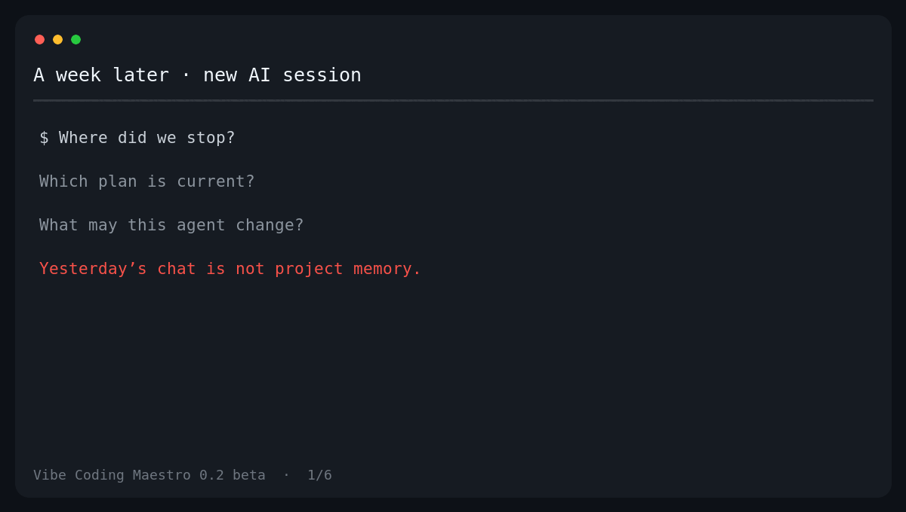

# Vibe Coding Maestro

<p align="center">
  <strong>Keep AI coding context in the repo—not in yesterday’s chat.</strong>
</p>

<p align="center">
  <a href="https://github.com/omikhaylov76-commits/vibe-coding-maestro/actions/workflows/ci.yml"></a>
  <a href="LICENSE"></a>
</p>

<p align="center">
  <a href="#quick-start">Quick start</a>
  ·
  <a href="#первые-шаги-по-русски">Первые шаги по-русски</a>
  ·
  <a href="docs/USER_GUIDE.md">Подробное руководство на русском</a>
  ·
  <a href="#safety-by-default">Safety</a>
  ·
  <a href="#documentation">Documentation</a>
</p>

<p align="center">
  Читаете по-русски? Начните с раздела <a href="#первые-шаги-по-русски">«Первые шаги по-русски»</a>.
</p>

- **What it is.** A project folder with shared memory and working rules for AI coding agents: ordinary Markdown in Git, plus a `doctor` command that checks the folder is intact.
- **Who it is for.** Anyone who builds something with Claude Code, Codex or a similar agent for longer than one chat—including people who do not write code themselves.
- **What it is not.** Not another coding agent or IDE. Keep your tools; Maestro gives them, and you, the same map.

## Quick start

Open a terminal (Terminal on macOS, PowerShell on Windows) and run one command:

```bash
npx create-vibe-maestro@latest
```

You need Node.js 20.10 or newer (it brings npm; get it at nodejs.org), Git (git-scm.com) and Claude Code or another coding agent; `node --version` and `git --version` show whether the first two are installed.

What you will see next:

1. A short guided setup with no more than three decisions: create a new project or check an existing one, the project name, and what you start from: an idea, materials, a ready description or existing code. A simple name creates the folder on your Desktop; an explicit path always wins.
2. A new project folder with its first Git commit and a passed check. The panel «ПРОЕКТ ГОТОВ» shows where the project is.
3. The next steps, printed in the same panel: open the folder in Claude Code and type `/start`. From there the agent leads you with questions, one at a time.

The setup and the generated project speak Russian (English is planned before a global release), so the step-by-step section below is in Russian.

## Первые шаги по-русски

Здесь весь путь новичка — от команды до первого плана. Подробности — в [руководстве](docs/USER_GUIDE.md).

```text
создание → /start → /plan → человек утверждает план → /build одной порции → /handoff
```

1. **Создайте проект.** Откройте терминал (на Mac — программа «Терминал», в Windows — PowerShell) и наберите `npx create-vibe-maestro@latest`. Нужны Node.js версии 20.10 или новее (ставится с сайта nodejs.org) и Git (git-scm.com); проверить, что они есть, можно командами `node --version` и `git --version`. Мастер задаст до трёх вопросов: создать новый проект или проверить готовый, как назвать проект и с чего вы начинаете — с идеи, материалов, готового описания или кода. Папка появится на рабочем столе, а в конце вы увидите панель «ПРОЕКТ ГОТОВ» с её адресом.
2. **Откройте папку проекта в Claude Code**: выберите эту папку в приложении Claude Code либо в терминале наберите `cd`, пробел и адрес папки из панели, а затем `claude`.
3. **Материалы**, если есть, — заметки, требования, скриншоты — положите в `maestro/inbox/`. Готовый код оставьте, где лежит: агент спросит путь и прочитает его, ничего не меняя.
4. **Напишите `/start`** — знакомство с задачей. Агент сначала читает, что уже есть, потом спрашивает по одному вопросу: что делаем, для кого, что значит «готово», кто решает, как передавать пароли и ключи доступа. «Не знаю» — нормальный ответ. Можно прерваться и продолжить. В конце агент показывает сводку; после вашего «да» ответы записываются в проект.
5. **Напишите `/plan`** — попросите план. Агент называет, насколько большая задача и как строго её проверять (это классификация), — с причинами. Вы можете согласиться, изменить или сузить объём.
6. **Прочитайте черновик плана** — он появится в папке `wiki/plans/`; можно попросить агента пересказать его простыми словами. Пока план в состоянии `draft` (черновик), код писать нельзя: проверка отвечает `CODE_ALLOWED: NO`. В проекте обычной строгости (она стоит по умолчанию) и повышенной черновик до вас читает второй агент и говорит, что нашёл.
7. **Утвердите план сами** — словами «план утверждаю». После этих слов агент записывает утверждение в план и ставит на текст отпечаток (контрольную сумму): если план потом изменится, проверки это заметят. Maestro не может механически отличить, кто записал утверждение — человек или агент: следите, чтобы оно появлялось только после ваших слов.
8. **Проверка перед кодом** — `preflight`. Агент запускает её сам перед первой строкой кода; она отвечает, можно ли начинать.
9. **Напишите `/build`** — лучше в новом разговоре с агентом. Агент делает ровно одну порцию плана и правит только файлы, названные в плане; затем сам запускает тесты и `doctor`, записывает передачу дел (`/handoff`) и говорит итог простыми словами. Следующая порция — снова `/build`, в новом разговоре.

Всё состояние проекта живёт в обычных текстовых файлах внутри проекта. Новый разговор с агентом начинается не с нуля, а с файла `wiki/hot.md` («что сейчас»), плана и последней передачи дел.

Слова, которые встретятся: **порция** — одна ограниченная часть работы из плана (в английских разделах — slice); **сессия** — один разговор с агентом; **передача дел** — запись «где остановились» для следующей сессии, её делает команда `/handoff`; `doctor` — проверка, что файлы Maestro целы; `preflight` — проверка, можно ли писать код.

### Что делает человек, а что агент

| Человек | Агент |
|---|---|
| Ставит цель и границы | Читает, что есть, и предлагает классификацию |
| Утверждает план | Пишет черновик плана и останавливается на `CODE_ALLOWED: NO` |
| Отвечает на вопросы, которые понимает и за которые отвечает | Сам запускает тесты и проверки и сверяет работу с целью порции |
| Смотрит итог и решает, что принять | Делает одну разрешённую порцию и готовит `/handoff` |

### Откуда запускать команды

- `/start`, `/plan`, `/build`, `/status`, `/wiki`, `/handoff` — внутри **папки проекта**, открытой в Claude Code.
- `doctor`, `preflight`, `sources`, `upgrade` агент запускает сам. Если хотите запустить их руками — тоже из **папки проекта**, в терминале, с `--path .`. Точная команда с версией вашего проекта записана в его `.claude/rules/maestro.md`; общая форма такая:

```bash
# из папки проекта
npx --package create-vibe-maestro@latest vibe-maestro preflight --path .
npx --package create-vibe-maestro@latest vibe-maestro doctor --path .
```

Ожидаемый ответ `doctor`:

```text
Vibe Coding Maestro doctor: всё сходится.
- git-no-remote: Копии проекта в облаке нет: у репозитория нет remote. …
```

Вторая строка — подсказка, а не ошибка: у проекта пока нет копии в облаке, например на GitHub. `@latest` — самая новая версия Maestro; если она новее вашего проекта, `doctor` скажет об этом и напечатает точные команды.

### Размер плана — по размеру задачи

| Масштаб | Что создаётся |
|---|---|
| `QUICK` | mini-plan в `wiki/plans/` — короткий план для мелкой задачи, тот же путь |
| `FEATURE` | один план в `wiki/plans/` |
| `PROJECT` | полный план в одном файле |
| `PROGRAM` / `INTEGRATION` | `wiki/programs/`: программа, её фазы и список исходников |

Активный план всегда лежит в `wiki/plans/`: только эту папку проверяют `doctor` и `preflight`.

Другие агенты и окна: агент без команд (Codex и другие) проходит те же шаги по файлам `protocols/start.md` и `protocols/plan.md`; в Cowork план просят фразой «план» по подсказке `maestro/runbooks/cowork-plan.md`. Это разные двери в одни и те же правила.

Два законченных примера — простой лендинг и портал из двух существующих игр — разобраны в [руководстве](docs/USER_GUIDE.md#два-примера-от-идеи-до-первой-порции). Там же — разделы про [`sources`](docs/USER_GUIDE.md#инвентаризация-существующих-исходников), [`preflight`](docs/USER_GUIDE.md#preflight-механический-гейт-перед-кодом), [`upgrade`](docs/USER_GUIDE.md#обновление-проекта-на-новую-версию) и [что делать, если проверка не пускает к коду](docs/USER_GUIDE.md#если-что-то-пошло-не-так).

## Why it exists

When an AI-assisted project lasts longer than one chat, the same problems keep returning:

- a new session has to rediscover the project;
- decisions survive in old conversations but not in the repository;
- the plan, code, and documentation quietly drift apart;
- different agents receive different instructions;
- nobody can quickly prove which files and rules are still intact.

Vibe Coding Maestro creates one durable, Git-native place for that context: shared Markdown memory, canonical working protocols, thin entry files for AI tools, and a deterministic `doctor` that checks mechanical integrity without calling an LLM.



The recording shows project creation and `doctor` in an earlier beta; `/start` and the plan step were added after it.

### Before and after

| Before Maestro | With Maestro |
|---|---|
| Decisions are scattered across chats | Confirmed context lives in Markdown and Git |
| Each agent gets a different explanation | `AGENTS.md`, `CLAUDE.md`, and adapters route to canonical protocols |
| “Where did we stop?” requires a long recap | `wiki/hot.md` and handoffs hold the current state and next step |
| Drift is noticed manually, often late | `doctor` checks known mechanical invariants deterministically |
| Ownership is implicit | Managed, project-owned, generated, merged, and immutable paths are explicit |

## What you get

A Standard project starts with a structure like this:

```text
My Project/
├── AGENTS.md          # yours: entry for Codex and other AGENTS.md tools
├── CLAUDE.md          # yours: project instructions for Claude Code
├── README.md          # yours: only when the folder had no README; rewrite it for your reader
├── .claude/rules/     # maestro.md (Maestro rules, loaded every session) + project.md (yours)
├── .claude/settings.json  # yours: default deny/ask rules (Maestro files, push, publish)
├── .claude/commands/  # /start, /status, /plan, /build, /wiki, /handoff adapters
├── .claude/agents/    # read-only code-reviewer and explorer
├── protocols/         # eight canonical protocols: start, plan, build, audit, wiki, status, handoff, completion
├── wiki/              # shared memory: start answers, plans, decisions, progress, audits, passport, restore page
├── maestro/           # inbox for your materials (kept byte for byte), runbooks, and templates
└── .maestro/          # manifest, ownership inventory and integrity metadata
```

The important part is not the number of files. It is the reading path every new session receives: `wiki/hot.md` first, then the capsule of the current slice, the active plan and open check reports—and from each only the part the session needs.

Claude Code projects receive six thin commands:

- `/start` — the first session: read what already exists, then agree on the task and on how we work, one question at a time;
- `/status` — read current context without changing files;
- `/plan` — follow the canonical planning protocol up to the human approval gate;
- `/build` — follow the canonical build protocol;
- `/wiki` — reconcile allowed project memory;
- `/handoff` — record the state and update `wiki/hot.md`.

## A normal working cycle

Material in `maestro/inbox/` → `/start` → plan → human approval → one bounded slice with tests and live evidence → `doctor` → handoff → a new session for the next slice. What keeps that cycle honest over weeks:

- **One slice at a time.** The agent edits only the files the plan names and stops at the slice's stop gate.
- **Goal check.** Each slice has a numbered list of criteria. A handoff in the middle of a slice says how many are proven; when the count does not grow twice in a row, the agent changes its approach and says so. Your «да» does not replace met criteria, and you are not asked whether the work is done.
- **Sessions stay affordable.** `vibe-maestro context` tells the agent how large the session has grown and, near the limit, about how many steps are left before a new session is cheaper. A new session reads the short capsule of the slice, not the whole history.
- **Checks run once.** A plan audit before approval and one code review per slice (not in `light` projects), then only the fixes are re-checked. Findings have stable IDs on one `critical | high | medium | low` scale; open `high` or `critical` findings block a green `doctor`; a `medium` or `low` finding that will not be fixed is closed with the reason and a note where it is recorded.
- **Nothing open gets lost.** What waits for you and visible defects are carried from handoff to handoff in `wiki/hot.md`; “later” goes to `wiki/icebox.md`. A handoff marks what the agent did not check itself and lists what it decided on its own.
- **Memory does not grow without end.** `archive` moves old memory into an archive inside the project, and `doctor` says when memory falls behind the code.
- **Delivery.** `protocols/completion.md` walks through closing: criteria checked, tests green, a delivery tag, a complete project passport (`wiki/passport.md`: where everything lives, names of environment variables but never their values), customer documents, a final handoff; `vibe-maestro pack` builds the customer archive from the delivery tag.

## Choose a depth

All depths are projections of one canonical system, not separate products.

| Depth | Best for | What changes |
|---|---|---|
| `light` | Small experiments and short projects | Minimal continuity and integrity surface |
| `standard` | Most solo and small-team projects | Full planning, progress, review, and handoff path; default |
| `advanced` | Longer or higher-risk work | Additional architecture, seams, audit, and lessons contracts |

The guided setup uses `standard`, so a new user does not have to decide immediately. Scripts choose with `--depth light|standard|advanced`.

## When Maestro helps—and when it does not

Maestro is a good fit when:

- an AI-assisted project lasts more than a few sessions;
- you switch between people, models, or coding interfaces;
- you repeatedly explain the same constraints and decisions;
- Git state, ownership, auditability, and safe handoff matter;
- you want portable Markdown rather than provider-locked chat memory.

Maestro is probably unnecessary when:

- the task is a one-off script or a short disposable prototype;
- you do not use Git or filesystem-aware AI tools;
- you want an agent that works with no plan and no approval from you;
- you need to retrofit an existing non-canonical repository today;
- you need enterprise access control, cloud sync, SSO, or a hosted dashboard.

Maestro also cannot replace project tests, backups, code review, or human judgment.

> [!WARNING]
> **Maestro creates new projects only.** It can re-check a complete project created by the same canonical engine, and `vibe-maestro upgrade` moves a provably canonical project forward from an earlier published version (0.2.0-beta.1, 0.3.0-beta.1 – 0.3.0-beta.4, 0.3.0, 0.3.1, 0.4.0, 0.4.1, 0.4.2, 0.4.3, 0.4.4, 0.4.5). It refuses to modify a non-empty, non-canonical directory, and no flag overrides that refusal. Safe conversion of arbitrary existing projects belongs to a separate future Converter.

## Safety by default

Maestro is deliberately conservative around existing data and Git state:

- it refuses a non-empty, non-canonical destination before writing;
- a copied or forged manifest is not enough—the canonical identity, inventory, and actual tree must agree;
- repeat initialization is not an implicit repair command: an incomplete canonical tree is rejected without writing;
- user-owned files are not silently overwritten or deleted;
- protected paths and their parents are checked for symlinks, including dangling links;
- Git bootstrap uses `main`, does not run `git add -A` over unrelated work, and does not change global Git configuration;
- `doctor` is deterministic, has versioned JSON output, and makes no LLM call; `doctor --strict` also treats warnings as blocking; there is intentionally no `doctor --fix` that could overwrite useful work;
- audit findings must be resolved with evidence; `waived` is not accepted;
- when the approval digest is recorded (the protocol asks the agent to), a later change of the plan text or its classification closes the gate until a human approves again — a tripwire, not a lock;
- `.claude/settings.json` ships default rules for Claude Code: its file tools are denied Maestro files, and `git push`, `npm publish`, `rm -rf` and `git reset --hard` ask first; this is not a sandbox, and the file belongs to the project, so a team can change the rules — see [how to tune protections for a project](docs/USER_GUIDE.md#как-подстроить-защиты-под-проект) (Russian);
- API keys live only in `.env`, which `.gitignore` excludes and `doctor` reports if Git tracks it; the agent writes a key you paste into `.env` itself, or opens `.env` in an editor for you to paste it (a key typed into the chat stays in the session history);
- `sources` reads existing code read-only and writes nothing without an explicit `--write`;
- `pack` builds the customer archive only from a delivery tag, leaves Maestro and agent folders out, adds `HANDOVER.md` with «change all passwords and keys», refuses on common kinds of secrets (a sieve, not a guarantee) or an incomplete passport, and gives the same bytes for the same tag; `pack --dry-run` shows the archive list first;
- `upgrade` is a dry run without `--apply` (`--diff` prints the changes themselves), refuses a modified managed file, removes only untouched Maestro files that left the canon, and rolls back a failed apply; `archive` moves old memory inside the project the same way — nothing deleted, text byte for byte except link addresses;
- generated projects pin the exact Maestro version instead of `@latest`, so a new release cannot change a project's checks until someone runs `upgrade`.

These protections reduce accidental damage. They do **not** make Maestro a sandbox, backup system, digital signature, or proof that the code and product decisions are correct. Read the complete [threat model](docs/THREAT_MODEL.md).

## Integration status

The core format is vendor-neutral; integration depth is not identical across tools.

| Interface | Level | What is available |
|---|---|---|
| Humans | Native | Plain Markdown, Git diffs, explicit ownership, runbooks |
| Claude Code | Native adapter | `.claude/rules/` loaded every session, six project commands including `/start` and `/plan`, read-only reviewer and explorer, default `settings.json` |
| Codex and other `AGENTS.md` tools | Generic adapter | Universal `AGENTS.md` entry into canonical protocols |
| Cursor and other filesystem-aware tools | Generic | They can read the same Markdown; no dedicated adapter yet |
| Cowork-style research/audit | Runbook | Copyable plan, discovery, and independent-audit workflows; human imports the result |

Claude Code and Cowork are two different doors into the same `protocols/plan.md`; neither of them owns planning rules. “Generic” means the shared files are usable; it does not claim the same tested UX as the native Claude Code adapter.

## Updating a project

> [!IMPORTANT]
> **0.4.6 is published on npm.** Every generated project records the exact Maestro version it was created with, so its checks do not change under it when a new version is published; `vibe-maestro upgrade` moves it forward when you decide. Interfaces may still change before 1.0.

Run the preview from the project folder; it writes nothing:

```bash
npx --package create-vibe-maestro@latest vibe-maestro upgrade --path .
```

It lists every file it would add, update or remove, with changed line counts, and prints the exact command, with the exact version, that applies the change (`--apply`); `--diff` prints the changes line by line. A file you edited by hand is never overwritten or removed: the upgrade stops and names it. After applying, add the changed files to Git, review and commit them — until then `doctor` reports the uncommitted Maestro files — then run `doctor --strict` with the same version.

What a move changes:

- **to 0.4.6** from 0.4.5 — twelve Maestro files get new text; nothing is added or removed, and project files such as `wiki/hot.md`, the log and existing capsules are not touched;
- **to 0.4.3** — ten small protocols are removed (their text moved into `protocols/build.md`, `protocols/audit.md` and `protocols/wiki.md`), and `maestro/templates/audit.md` and `wiki/icebox.md` are added;
- **to 0.4.2** from 0.4.1 or earlier — the `/start` command and protocol, `maestro/inbox/.gitattributes` and `wiki/restore.md` are added, and a `README.md` only if the project has none; if materials already sit in `maestro/inbox/`, run `git add --renormalize maestro/inbox` before committing so Git keeps them byte for byte.

The [changelog](CHANGELOG.md) has the full list for every version.

## Automation and CI

For scripts, pass every decision explicitly:

```bash
npx create-vibe-maestro@latest --yes --target "My Project" --name "My Project" --start materials --depth standard --json
```

`--start` is `idea`, `materials`, `spec` or `code`. Two optional flags: `--github` creates a private GitHub repository after the first commit (it needs the GitHub CLI `gh`, logged in; a `gh` failure is only a warning with the command for later), and `--push-without-asking` lets the agent run a plain `git push` without a question while force pushes still ask. Without them `create --yes` creates no repository and keeps the default protections. Set `NO_COLOR=1` for plain output.

Service commands (run from the project folder; in a real project use the exact version from its `.claude/rules/maestro.md`):

```bash
npx --package create-vibe-maestro@latest vibe-maestro doctor --path . --json
npx --package create-vibe-maestro@latest vibe-maestro doctor --path . --strict
npx --package create-vibe-maestro@latest vibe-maestro skills --path .
npx --package create-vibe-maestro@latest vibe-maestro preflight --path . --json
npx --package create-vibe-maestro@latest vibe-maestro sources --path . --source "../durak" --source "../dice-poker"
npx --package create-vibe-maestro@latest vibe-maestro archive --path .
npx --package create-vibe-maestro@latest vibe-maestro context --path .
```

`preflight` and `doctor` exit `0` when the check passes and `1` when it blocks; `sources`, `upgrade` and `archive` write nothing at all unless you add `--write` or `--apply`.

The repository release gate covers tests, type checking, build, audit, source acceptance, packed-tarball installation, all three depths, paths with spaces, deterministic doctor JSON, protocol drift, canonical identity forgery, incomplete canonical trees, forbidden audit waivers, symlink boundaries, and upgrades from projects created by every published version since the 0.3 betas, up to 0.4.5. Pull requests and `main` run on Ubuntu, macOS, and Windows with Node.js 20 and 22; a branch push runs one quick Ubuntu job.

## Not available yet

- safe conversion of existing non-canonical projects (`upgrade` covers only canonical projects of known versions);
- English-generated templates;
- cloud sync, accounts, team dashboard, or billing;
- automatic installation or execution of third-party skills;
- a guarantee that an AI agent will not make mistakes.

What comes next is listed in the [roadmap](docs/ROADMAP.md).

## Documentation

- [Detailed user guide (Russian)](docs/USER_GUIDE.md)
- [Changelog](CHANGELOG.md)
- [Threat model](docs/THREAT_MODEL.md)
- [Canonical-only boundary and future Converter](docs/MIGRATION_V1.md)
- [Roadmap](docs/ROADMAP.md)
- [Contributing, building from source, and local release gates](CONTRIBUTING.md)

Found a confusing step or a safety problem? Please [open an issue](https://github.com/omikhaylov76-commits/vibe-coding-maestro/issues/new) with the command you ran, expected result, actual result, OS, Node version, and a redacted tree or log. Never include credentials or private source material.

## License

[MIT](LICENSE). The project memory format, core CLI, doctor, base protocols, and security fixes remain open source.
