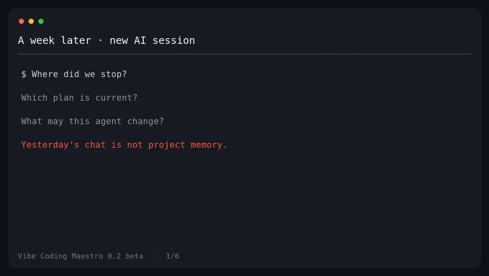

# Vibe Coding Maestro

<p align="center">
  <strong>Keep AI coding context in the repo—not in yesterday’s chat.</strong>
</p>

<p align="center">
  Open-source project memory and guardrails for long-running AI coding work.<br>
  Ordinary Markdown in Git, shared by people and different AI coding tools.
</p>

<p align="center">
  <a href="https://github.com/omikhaylov76-commits/vibe-coding-maestro/actions/workflows/ci.yml"></a>
  <a href="LICENSE"></a>
</p>

<p align="center">
  <a href="docs/USER_GUIDE.md">Подробное руководство на русском</a>
  ·
  <a href="#quick-start">Quick start</a>
  ·
  <a href="#safety-by-default">Safety</a>
  ·
  <a href="#documentation">Documentation</a>
</p>

> [!IMPORTANT]
> **0.3.0-beta.4 is a public beta on npm.** Create a project with `npx create-vibe-maestro@latest`. Every generated project records the exact Maestro version in its `CLAUDE.md` and `AGENTS.md`, so its checks do not change under it when a new version is published; `vibe-maestro upgrade` moves it forward when you decide. Interfaces may still change between beta versions. The current CLI and generated project templates are Russian-first; English localization is planned before a global release.

When an AI-assisted project lasts longer than one chat, the same problems keep returning:

- a new session has to rediscover the project;
- decisions survive in old conversations but not in the repository;
- the plan, code, and documentation quietly drift apart;
- different agents receive different instructions;
- nobody can quickly prove which files and rules are still intact.

Vibe Coding Maestro creates one durable, Git-native place for that context. It gives the project shared Markdown memory, canonical working protocols, thin entry files for AI tools, and a deterministic `doctor` that checks mechanical integrity without calling an LLM.

It is **not another coding agent or IDE**. Keep using Claude Code, Codex, Cursor, or your preferred tools. Maestro gives them—and you—the same map.

## See the workflow in 20 seconds



The recording shows the real create-and-`doctor` surface of the beta CLI; the Planning Gate flow below was added after it.

## Quick start

**Requirements:** Node.js 20.10 or newer, npm, and Git. Nothing to clone or build.

Run the guided setup:

```bash
npx create-vibe-maestro@latest
```

The Guided First Run explains where files will be created and asks for no more than three decisions. A simple project name creates the folder on your Desktop; an explicit path always wins. Set `NO_COLOR=1` if you need plain output.

Or pass every decision explicitly:

```bash
npx create-vibe-maestro@latest --yes --target "My Project" --name "My Project" --start idea --depth standard
```

Maestro creates the project, initializes Git on `main`, makes the initial commit, and runs `doctor`. To check it again later, open the project folder and run the command written in its `CLAUDE.md` (it names the exact version the project uses):

```bash
cd "My Project"
npx --package create-vibe-maestro@latest vibe-maestro doctor --path .
```

Expected result:

```text
Vibe Coding Maestro doctor: всё сходится.
```

`@latest` above is the newest published Maestro. If it is newer than your project, `doctor` says so and prints the exact commands to check the project with its own version or to upgrade it.

> [!WARNING]
> **Core 0.3 creates new canonical projects only.** It can also re-check a complete project already created by the same canonical engine, and `vibe-maestro upgrade` can evolve a provably canonical project created by an earlier published version (0.2.0-beta.1, 0.3.0-beta.1 – 0.3.0-beta.3). It refuses to modify a non-empty, non-canonical directory, and no flag overrides that refusal. Safe conversion of arbitrary existing projects belongs to a separate future Converter.

## Что дальше после создания проекта: Planning Gate

Проект создан — **откройте созданную папку** (`My Project`) в Claude Code или Cowork. Дальше работа идёт по одному маршруту: сначала план, который утверждает человек, и только потом код.

```text
обсудить идею → /plan → классификация → черновик плана
→ человек утверждает → preflight → /build одной порции → тесты и doctor → /handoff
```

1. **Обсудите идею** обычными словами прямо в чате агента. Материалы — заметки, требования, скриншоты — положите в `maestro/inbox/`.
2. **Попросите план.** В Claude Code это команда `/plan`, в Cowork — фраза «план» по runbook `maestro/runbooks/cowork-plan.md`. Это две разные двери в один и тот же канонический `protocols/plan.md`.
3. **Проверьте классификацию.** Агент называет масштаб, режим, глубину гарантий, риск и профили с причинами. Вы можете принять её, изменить или сузить объём.
4. **Покажите существующий код**, если он есть: команда `sources` читает его read-only и по умолчанию ничего не пишет.
5. **Получите черновик** в `wiki/plans/<номер>-<слаг>.md`. Пока он `draft`, гейт показывает `CODE_ALLOWED: NO`.
6. **Утвердите план сами** — словами «план утверждаю». Утверждение записывается в поля `approved_by` и `approved_at`. Maestro не может механически отличить, кто их заполнил — человек или агент: следите, чтобы они появлялись только после ваших слов.
7. **Проверьте право на код** механическим гейтом `preflight` (команды ниже).
8. **`/build` ровно одной порции** → тесты → `doctor` → `/handoff`.

### Откуда запускать команды

- `/plan`, `/build`, `/status`, `/wiki`, `/handoff` — внутри **папки проекта**, открытой в Claude Code.
- `doctor`, `preflight`, `sources`, `upgrade` — тоже из **папки проекта**, через `npx`, с `--path .`. Точная команда с версией вашего проекта записана в его `CLAUDE.md` и `AGENTS.md`; ниже — общая форма:

```bash
# из папки проекта
npx --package create-vibe-maestro@latest vibe-maestro preflight --path .
npx --package create-vibe-maestro@latest vibe-maestro doctor --path .
```

### Глубина планирования подстраивается под масштаб

| Масштаб | Что создаётся |
|---|---|
| `QUICK` | mini-plan в `wiki/progress/`, без тяжёлого пакета планирования |
| `FEATURE` | один план `wiki/plans/<номер>-<слаг>.md` |
| `PROJECT` | полный пакет планирования в одном основном плане |
| `PROGRAM` / `INTEGRATION` | `wiki/programs/<слаг>/`: программа, фазы и source inventory |

В 0.3 beta активный план обязан лежать в `wiki/plans/`: только этот каталог проверяют `doctor` и `preflight`. `wiki/programs/<слаг>/` в этой бете — проектные материалы программы, не проверяемые doctor.

### Что делает человек, а что агент

| Человек | Агент |
|---|---|
| Ставит цель и границы | Собирает вход и предлагает классификацию |
| Принимает или меняет классификацию | Пишет черновик плана нужного объёма |
| Утверждает план и каждую фазу программы | Останавливается на `CODE_ALLOWED: NO` |
| Закрывает блокирующие вопросы | Исполняет одну разрешённую порцию и останавливается на её стоп-гейте |
| Просматривает diff и решает, что мержить | Прогоняет тесты, `doctor` и готовит `/handoff` |

Два законченных примера — простой лендинг и портал из двух существующих игр — разобраны в [руководстве](docs/USER_GUIDE.md#два-примера-от-идеи-до-первой-порции). Там же — разделы про [`sources`](docs/USER_GUIDE.md#инвентаризация-существующих-исходников), [`preflight`](docs/USER_GUIDE.md#preflight-механический-гейт-перед-кодом), [`upgrade`](docs/USER_GUIDE.md#обновление-проекта-на-новую-версию) и [что делать, если гейт закрыт](docs/USER_GUIDE.md#если-что-то-пошло-не-так).

Всё состояние проекта живёт в Markdown внутри Git. Новая сессия агента начинает не с нуля, а с `wiki/hot.md`, активного плана и последнего handoff.

## What you get

A Standard project starts with a structure like this:

```text
My Project/
├── AGENTS.md          # universal entry for compatible AI agents
├── CLAUDE.md          # Claude Code entry
├── .claude/commands/  # /status, /plan, /build, /wiki, /handoff adapters
├── protocols/         # canonical rules for planning, building and handoff
├── wiki/              # shared memory: plans, decisions, progress and audits
├── maestro/           # inbox and human-controlled discovery/audit runbooks
└── .maestro/          # manifest, ownership inventory and integrity metadata
```

The important part is not the number of files. It is the reading path every new session receives:

```text
wiki/hot.md
→ discovery
→ open audits
→ roadmap
→ current progress
```

From there, `protocols/build.md` routes the agent through the relevant rules, plan, tests, evidence, review, and handoff. The next session can continue from repository state instead of relying on a private chat transcript.

### Before and after

| Before Maestro | With Maestro |
|---|---|
| Decisions are scattered across chats | Confirmed context lives in Markdown and Git |
| Each agent gets a different explanation | `AGENTS.md`, `CLAUDE.md`, and adapters route to canonical protocols |
| “Where did we stop?” requires a long recap | `wiki/hot.md` and handoffs hold the current state and next step |
| Drift is noticed manually, often late | `doctor` checks known mechanical invariants deterministically |
| Ownership is implicit | Managed, project-owned, generated, merged, and immutable paths are explicit |

## A normal working cycle

The guided path above is the whole cycle: material in `maestro/inbox/` → plan → human approval → one bounded build with tests and live evidence → `doctor` → handoff. Independent audit findings are recorded with stable IDs; open `high` or `critical` findings block a green doctor result.

Claude Code projects receive five thin commands:

- `/status` — read current context without changing files;
- `/plan` — follow the canonical planning protocol up to the human approval gate;
- `/build` — follow the canonical build protocol;
- `/wiki` — reconcile allowed project memory;
- `/handoff` — record the state and update `wiki/hot.md`.

## Safety by default

Maestro is deliberately conservative around existing data and Git state:

- it refuses a non-empty, non-canonical destination before writing;
- a copied or forged manifest is not enough—the canonical identity, inventory, and actual tree must agree;
- repeat initialization is not an implicit repair command: an incomplete canonical tree is rejected without writing;
- user-owned files are not silently overwritten or deleted;
- protected paths and their parents are checked for symlinks, including dangling links;
- Git bootstrap uses `main`, does not run `git add -A` over unrelated work, and does not change global Git configuration;
- `doctor` is deterministic, has versioned JSON output, and makes no LLM call;
- `doctor --strict` also treats warnings as blocking;
- audit findings must be resolved with evidence; `waived` is not accepted by the 0.3 beta contract;
- `sources` reads existing code read-only and writes nothing without an explicit `--write`;
- `upgrade` is a dry run without `--apply`, refuses a modified managed file, and rolls back a failed apply;
- generated projects pin the exact Maestro version instead of `@latest`, so a new release cannot change a project's checks until someone runs `upgrade`;
- there is intentionally no `doctor --fix` that could overwrite useful work.

`doctor` checks known mechanical boundaries such as manifest identity, ownership inventory, managed checksums, protocol contracts, wiki links, source integrity, tracked environment files, audit structure, blocking findings, and protected-path symlinks.

These protections reduce accidental damage. They do **not** make Maestro a sandbox, backup system, digital signature, or proof that the code and product decisions are correct. Read the complete [threat model](docs/THREAT_MODEL.md).

## Choose a depth

All depths are projections of one canonical system, not separate products.

| Depth | Best for | What changes |
|---|---|---|
| `light` | Small experiments and short projects | Minimal continuity and integrity surface |
| `standard` | Most solo and small-team projects | Full planning, progress, review, and handoff path; default |
| `advanced` | Longer or higher-risk work | Additional architecture, seams, audit, and lessons contracts |

Choose non-interactively with `--depth light|standard|advanced`. The Guided First Run uses `standard` by default so a new user does not have to decide immediately.

## When Maestro helps—and when it does not

### Maestro is a good fit when

- an AI-assisted project lasts more than a few sessions;
- you switch between people, models, or coding interfaces;
- you repeatedly explain the same constraints and decisions;
- Git state, ownership, auditability, and safe handoff matter;
- you want portable Markdown rather than provider-locked chat memory.

### Maestro is probably unnecessary when

- the task is a one-off script or a short disposable prototype;
- you do not use Git or filesystem-aware AI tools;
- you want an autonomous agent that designs and writes the product for you;
- you need to retrofit an existing non-canonical repository today;
- you need enterprise access control, cloud sync, SSO, or a hosted dashboard.

Maestro also cannot replace project tests, backups, code review, or human judgment.

## Integration status

The core format is vendor-neutral; integration depth is not identical across tools.

| Interface | Level in 0.3 beta | What is available |
|---|---|---|
| Humans | Native | Plain Markdown, Git diffs, explicit ownership, runbooks |
| Claude Code | Native adapter | `CLAUDE.md`, five project commands including `/plan`, code-reviewer adapter |
| Codex and other `AGENTS.md` tools | Generic adapter | Universal `AGENTS.md` entry into canonical protocols |
| Cursor and other filesystem-aware tools | Generic | They can read the same Markdown; no dedicated adapter yet |
| Cowork-style research/audit | Runbook | Copyable plan, discovery, and independent-audit workflows; human imports the result |

Claude Code and Cowork are two different doors into the same `protocols/plan.md`; neither of them owns planning rules.

“Generic” means the shared files are usable; it does not claim the same tested UX as the native Claude Code adapter.

## Updating a project

Run the preview from the project folder; it writes nothing:

```bash
npx --package create-vibe-maestro@latest vibe-maestro upgrade --path .
```

It lists every file it would add or update and prints the exact command, with the exact version, that applies the change (`--apply`). A file you edited by hand is never overwritten: the upgrade stops and names it. After applying, review the Git diff and commit it (until then `doctor` reports the uncommitted managed files), then run `doctor --strict` with the same version.

## Automation and CI

For scripts, pass every decision explicitly:

```bash
npx create-vibe-maestro@latest --yes --target "My Project" --name "My Project" --start materials --depth standard --json
```

Useful service commands (run from the project folder; in a real project use the exact version from its `CLAUDE.md`):

```bash
npx --package create-vibe-maestro@latest vibe-maestro doctor --path . --json
npx --package create-vibe-maestro@latest vibe-maestro doctor --path . --strict
npx --package create-vibe-maestro@latest vibe-maestro skills --path .
npx --package create-vibe-maestro@latest vibe-maestro preflight --path . --json
npx --package create-vibe-maestro@latest vibe-maestro sources --path . --source "../durak" --source "../dice-poker"
npx --package create-vibe-maestro@latest vibe-maestro upgrade --path .
```

`preflight` and `doctor` exit `0` when the check passes and `1` when it blocks; `sources` and `upgrade` write nothing at all unless you add `--write` or `--apply`.

The repository release gate covers tests, type checking, build, audit, source acceptance, packed-tarball installation, all three depths, paths with spaces, deterministic doctor JSON, protocol drift, canonical identity forgery, incomplete canonical trees, forbidden audit waivers, symlink boundaries, and upgrades from projects created by the published 0.3 betas. Pull requests and `main` run on Ubuntu, macOS, and Windows with Node.js 20 and 22; a branch push runs one quick Ubuntu job.

## Current beta scope

Available now in the npm beta:

- Guided First Run;
- fresh canonical project creation;
- Planning Gate: `/plan`, Cowork plan runbook, project plans, and the human approval gate;
- mechanical `preflight` before the first line of code;
- read-only `sources` inventory of existing code;
- safe `upgrade` of a provably canonical project from an earlier published version;
- exact Maestro version pinned in every generated project;
- `light`, `standard`, and `advanced` depth projections;
- shared project memory and handoffs;
- canonical protocols with thin adapters;
- manifest, ownership inventory, checksums, and deterministic doctor;
- safe Git bootstrap;
- discovery and independent-audit runbooks;
- project-local skill inventory;
- JSON and strict CI modes;
- source and packed-install acceptance.

Not available yet:

- safe conversion of existing non-canonical projects (`upgrade` covers only canonical projects of known versions);
- English-generated templates;
- cloud sync, accounts, team dashboard, or billing;
- automatic installation or execution of third-party skills;
- a guarantee that an AI agent will not make mistakes.

Known gaps that 0.3.0 is meant to close — the step from an approved plan to `/build`, project identity that survives a renamed folder, `doctor` complaints about edits the protocols themselves ask for — are listed in the [roadmap](docs/ROADMAP.md).

## Documentation

- [Detailed user guide (Russian)](docs/USER_GUIDE.md)
- [Changelog](CHANGELOG.md)
- [Threat model](docs/THREAT_MODEL.md)
- [Canonical-only boundary and future Converter](docs/MIGRATION_V1.md)
- [Roadmap](docs/ROADMAP.md)
- [Contributing, building from source, and local release gates](CONTRIBUTING.md)

Found a confusing step or a safety problem? Please [open an issue](https://github.com/omikhaylov76-commits/vibe-coding-maestro/issues/new) with the command you ran, expected result, actual result, OS, Node version, and a redacted tree or log. Never include credentials or private source material.

## License

[MIT](LICENSE). The project memory format, core CLI, doctor, base protocols, and security fixes remain open source.
